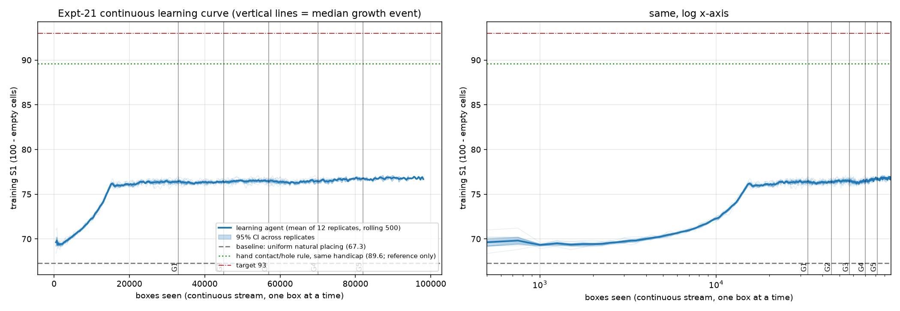
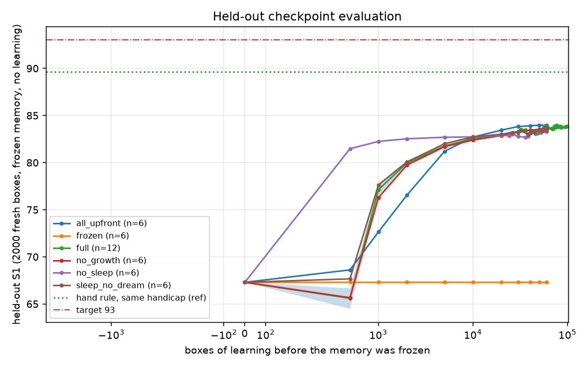
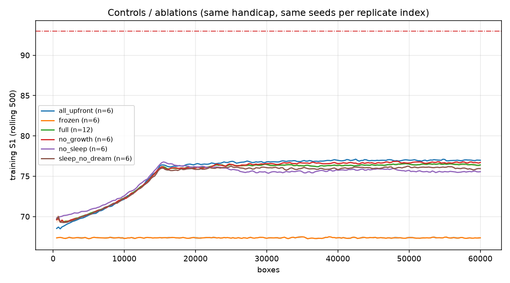

# Expt-21 - continuous learning with sleep consolidation and growth on saturation

Run folder: `20260930_233539_run` | code hash `db10d106f918499e` | wall time 137.4 min | 12 full replicates, 6 replicates per ablation x 60000 boxes

## Headline (full system)

- **Baseline (measured)**: uniform natural placing, handicap = at most 14 pieces per box: held-out S1 **67.30** (first 500 training boxes: 69.62).
- **Final (training stream, last 5000 boxes)**: S1 **76.53** (95% CI over replicates 76.40-76.65).
- **Final held-out (frozen memory, 2000 fresh boxes, near-greedy softmax)**: S1 **83.70** (83.61-83.79) at the last checkpoint of each stream.
- Target 93: **NOT reached** (held-out 83.70). Hand contact/hole rule under the same handicap (reference only, not used by the learner): 89.61. Expt-20 best hand rule on the unhandicapped box: 96-98 (context only, different task).
- Streams ended by: {'3_consecutive_growth_stages_without_gain': 5, '2_consecutive_growth_stages_without_gain': 4, 'saturated_at_final_stage': 3}.  Stream lengths: min 60000, max 98000.

## Learning curve: S1 at 0 / 1k / 10k / 50k / 100k boxes (training stream, mean of the 500 boxes ending there)

| boxes | S1 mean | 95% CI over replicates | replicates reaching it |
|---|---|---|---|
| 0 (baseline, held-out) | 67.30 | - | 12 |
| 1000 | 69.33 | 69.23 - 69.41 | 12 |
| 2000 | 69.42 | 69.31 - 69.53 | 12 |
| 5000 | 70.32 | 70.24 - 70.40 | 12 |
| 10000 | 72.28 | 72.19 - 72.37 | 12 |
| 20000 | 76.07 | 75.97 - 76.17 | 12 |
| 50000 | 76.50 | 76.41 - 76.59 | 12 |

## Growth stages (saturation events, full variant)

Saturation = upper 95%-bound of the S1 gain between two consecutive windows is below sat_delta; growth is then applied automatically (a stage that never saturates is forced to grow after max_stage_boxes).

| stage finished | name | replicates | median box | saturated (vs forced) | train S1 at end | gain vs previous stage | held-out S1 at end | memory entries |
|---|---|---|---|---|---|---|---|---|
| 0 | stage0 type+context(A) | 12 | 33000 | 100% | 76.46 | - | 83.37 | 4955 |
| 1 | G1 pair combos | 12 | 45000 | 100% | 76.29 | -0.17 | 83.11 | 5138 |
| 2 | G2 3x3 context | 12 | 58000 | 100% | 76.59 | +0.30 | 83.77 | 26252 |
| 3 | G3 triple combos + 2x STM | 10 | 69000 | 100% | 76.35 | -0.26 | 83.64 | 35898 |
| 4 | G4 5x5 context + 2x dreams | 5 | 82000 | 100% | 76.72 | +0.31 | 83.86 | 120903 |
| 5 | G5 capacity + 4x STM | 3 | 94000 | 100% | 76.79 | +0.09 | 83.80 | 155954 |

## Held-out checkpoints (full variant: memory frozen after N boxes, evaluated on the same fixed fresh boxes)

| boxes learned | held-out S1 | 95% CI (replicates) | attempts | frac S1>=90 | stage | memory entries | replicates |
|---|---|---|---|---|---|---|---|
| 0 | 67.30 | 67.30 - 67.30 | 14.0 | 0.00 | 0.0 | 0 | 12 |
| 500 | 65.60 | 64.48 - 66.66 | 14.0 | 0.00 | 0.0 | 2140 | 12 |
| 1000 | 77.14 | 76.51 - 77.74 | 13.8 | 0.00 | 0.0 | 3058 | 12 |
| 2000 | 79.95 | 79.68 - 80.24 | 13.5 | 0.00 | 0.0 | 3780 | 12 |
| 5000 | 81.76 | 81.63 - 81.89 | 13.2 | 0.00 | 0.0 | 4358 | 12 |
| 10000 | 82.52 | 82.37 - 82.66 | 13.2 | 0.00 | 0.0 | 4637 | 12 |
| 20000 | 82.91 | 82.80 - 83.00 | 13.3 | 0.01 | 0.0 | 4859 | 12 |
| 26000 | 83.15 | 82.80 - 83.39 | 13.3 | 0.01 | 0.0 | 4915 | 3 |
| 30000 | 83.19 | 83.06 - 83.33 | 13.3 | 0.01 | 0.3 | 4991 | 12 |
| 32000 | 83.51 | nan - nan | 13.3 | 0.01 | 0.0 | 4973 | 2 |
| 34000 | 83.38 | 83.20 - 83.57 | 13.3 | 0.01 | 0.0 | 4968 | 3 |
| 36000 | 83.46 | 83.35 - 83.59 | 13.3 | 0.01 | 0.0 | 4974 | 3 |
| 38000 | 83.02 | 82.88 - 83.14 | 13.4 | 0.00 | 1.0 | 5105 | 3 |
| 40000 | 83.13 | 83.05 - 83.23 | 13.4 | 0.00 | 1.2 | 8252 | 12 |
| 42000 | 83.26 | nan - nan | 13.4 | 0.00 | 1.0 | 5132 | 1 |
| 44000 | 83.21 | nan - nan | 13.4 | 0.01 | 1.0 | 5148 | 2 |
| 46000 | 83.07 | 82.97 - 83.18 | 13.4 | 0.00 | 1.0 | 5149 | 3 |
| 48000 | 83.12 | 83.05 - 83.22 | 13.4 | 0.00 | 1.0 | 5156 | 3 |
| 50000 | 83.49 | 83.38 - 83.59 | 13.5 | 0.01 | 2.2 | 22105 | 12 |
| 56000 | 83.71 | nan - nan | 13.4 | 0.01 | 2.0 | 26092 | 2 |
| 58000 | 83.86 | 83.82 - 83.91 | 13.4 | 0.01 | 2.0 | 26415 | 3 |
| 60000 | 83.60 | 83.50 - 83.71 | 13.5 | 0.01 | 2.8 | 30282 | 12 |
| 62000 | 83.68 | 83.52 - 83.85 | 13.5 | 0.01 | 2.8 | 33642 | 4 |
| 68000 | 83.62 | nan - nan | 13.6 | 0.01 | 3.0 | 35841 | 2 |
| 70000 | 83.59 | 83.50 - 83.66 | 13.6 | 0.00 | 3.0 | 36007 | 3 |
| 72000 | 83.86 | nan - nan | 13.5 | 0.01 | 3.0 | 35670 | 1 |
| 74000 | 83.71 | nan - nan | 13.6 | 0.01 | 3.0 | 36379 | 1 |
| 76000 | 83.96 | nan - nan | 13.5 | 0.01 | 4.0 | 124632 | 1 |
| 80000 | 83.79 | 83.68 - 83.90 | 13.5 | 0.01 | 4.0 | 108692 | 4 |
| 82000 | 83.87 | nan - nan | 13.6 | 0.01 | 4.0 | 120142 | 2 |
| 84000 | 83.87 | nan - nan | 13.5 | 0.01 | 4.0 | 119285 | 1 |
| 86000 | 83.74 | nan - nan | 13.5 | 0.01 | 4.0 | 120317 | 1 |
| 94000 | 83.78 | nan - nan | 13.5 | 0.01 | 5.0 | 155876 | 2 |
| 98000 | 83.84 | nan - nan | 13.5 | 0.01 | 5.0 | 156111 | 1 |

## Controls and ablations (all compared at 60000 boxes, held-out S1 after freezing)

| variant | replicates | held-out S1 | 95% CI | train S1 (last 5000) | full minus variant (95% CI) | mean final stage | memory entries | min/stream |
|---|---|---|---|---|---|---|---|---|
| all_upfront | 6 | 83.96 | 83.85 - 84.11 | 76.96 | -0.36 (-0.55, -0.19) | 5.0 | 213168 | 61.8 |
| no_growth | 6 | 83.62 | 83.55 - 83.70 | 76.69 | -0.02 (-0.15, +0.11) | 0.0 | 5040 | 35.6 |
| full | 12 | 83.60 | 83.50 - 83.71 | 76.45 | - | 3.5 | 78600 | 47.9 |
| sleep_no_dream | 6 | 83.42 | 83.25 - 83.59 | 75.98 | +0.18 (-0.02, +0.39) | 3.0 | 30845 | 36.5 |
| no_sleep | 6 | 83.29 | 83.17 - 83.42 | 75.55 | +0.32 (+0.14, +0.48) | 3.3 | 40106 | 33.9 |
| frozen | 6 | 67.30 | 67.30 - 67.30 | 67.35 | +16.31 (+16.20, +16.42) | 0.0 | 0 | 24.9 |

Variants: `full` sleep+dream+growth on saturation; `no_sleep` learns online after every box, no STM replay, no dreams (growth on saturation still active); `sleep_no_dream` sleeps (replay of real boxes) but never dreams; `no_growth` fixed stage-0 memory; `all_upfront` every feature and the largest memory from box 0 (no staged growth); `frozen` learning disabled (flatness check). The 'full minus variant' interval is a bootstrap over replicate means (independent replicates).

## Final memory (replicate 0)

- entries 35907 of 119808 slots; active features ['type', 'A', 'pair', 'S1', 'trip']; sleeps 340
- learned piece-type weights (cells of advantage): P +1.48, B +0.49, G +0.36, C +0.34, E +0.24, H +0.22, K +0.17, D +0.15, A +0.06, L -0.06, I -0.14, F -0.31, O -0.37, M -0.37, J -0.51, N -0.73
- best learned piece pairs: M+P (+0.52, n=2333), L+M (+0.42, n=357), B+M (+0.40, n=533), M+N (+0.38, n=480), G+M (+0.38, n=699), F+M (+0.37, n=508)
- worst learned piece pairs: P+P (-0.63, n=10206), J+J (-0.45, n=21), J+L (-0.43, n=105), C+P (-0.29, n=3948), F+P (-0.27, n=3568), I+I (-0.26, n=333)

## Files
`learning_curve.png/.csv`, `heldout_checkpoints.png/.csv`, `growth_stages.csv`, `leaderboard_ablations.csv`, `ablation_curves.png`, `ltm_full_seed0.pkl`, `streams/*.pkl` (per-box S1/attempts per stream), `progress.log`, `manifest.json`.