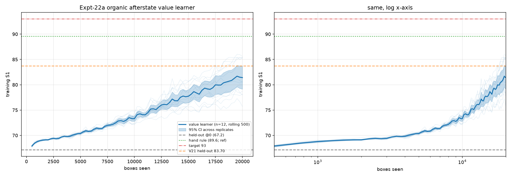
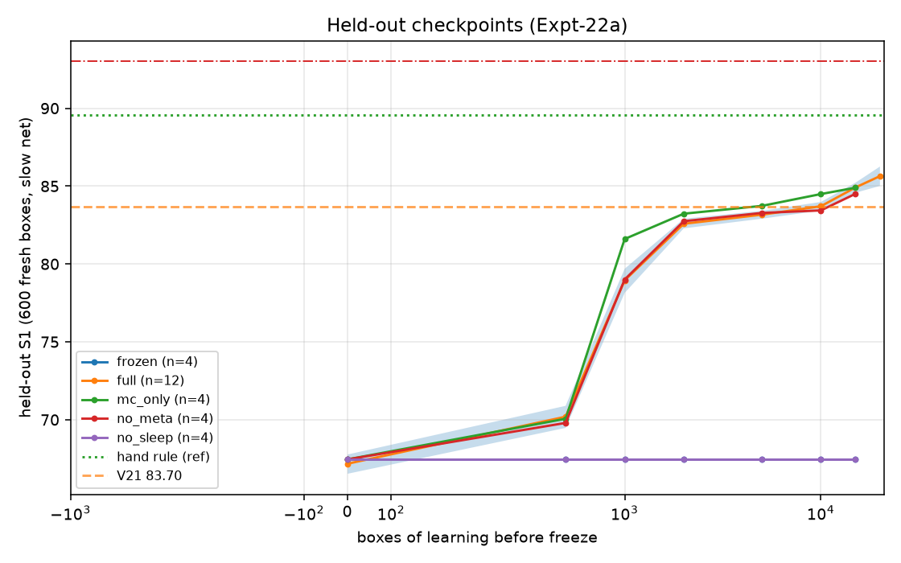
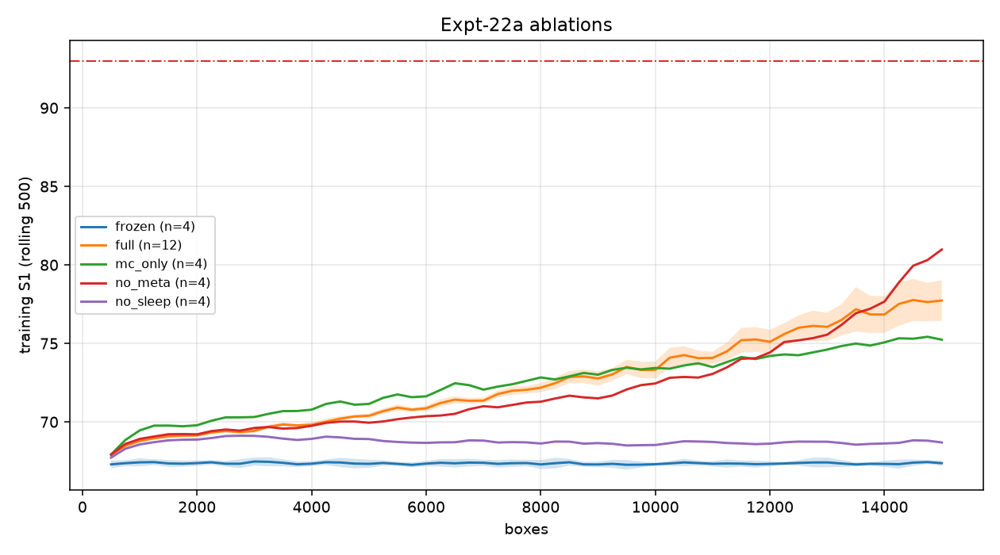

# Expt-22a — Organic Afterstate Value Learner

Run folder: `20261001_032026_run` | code hash `94f0d07925fb60b4` | wall time 62.7 min | 12 full replicates, abl_reps=4 × abl_boxes=15000

## Headline (full system)

- **Baseline held-out @0**: handicap ≤14 pieces/box, natural placing: **67.17** (first 500 training boxes: 67.90).
- **Final training (last ≤5000)**: S1 **79.96** (95% CI 78.49-81.40).
- **Final held-out (slow net)**: S1 **85.64** (85.01-86.26).
- Target 93: **NOT reached**. Hand rule (ref): 89.58. V21 held-out: 83.70. Beat V21: **YES**. Beat hand: **NO**.
- Stream lengths: min 20000, max 20000.

## Learning curve (training S1)

| boxes | S1 mean | 95% CI | n |
|---|---|---|---|
| 0 (held-out) | 67.17 | - | 12 |
| 1000 | 68.79 | 68.69-68.89 | 12 |
| 2000 | 69.14 | 69.07-69.22 | 12 |
| 5000 | 70.39 | 70.27-70.52 | 12 |
| 10000 | 73.31 | 72.87-73.75 | 12 |
| 20000 | 81.41 | 79.55-83.25 | 12 |

## Held-out checkpoints (full)

| boxes | held-out S1 | 95% CI | attempts | frac≥90 | hidden | concepts | n |
|---|---|---|---|---|---|---|---|
| 0 | 67.17 | 66.53-67.76 | 14.0 | 0.00 | 64 | 0 | 12 |
| 500 | 70.19 | 69.47-70.89 | 14.0 | 0.00 | 64 | 0 | 12 |
| 1000 | 78.95 | 78.14-79.69 | 13.8 | 0.00 | 64 | 0 | 12 |
| 2000 | 82.58 | 82.29-82.90 | 13.3 | 0.00 | 64 | 1 | 12 |
| 5000 | 83.17 | 82.91-83.41 | 13.3 | 0.01 | 64 | 2 | 12 |
| 10000 | 83.71 | 83.43-83.98 | 13.3 | 0.01 | 64 | 9 | 12 |
| 15000 | 84.91 | 84.57-85.22 | 13.4 | 0.02 | 91 | 21 | 12 |
| 20000 | 85.64 | 85.01-86.26 | 13.6 | 0.07 | 107 | 46 | 12 |

## Ablations (compared near 15000 boxes)

| variant | n | held-out S1 | 95% CI | train last5k | full−var (CI) | hidden | concepts | min/stream |
|---|---|---|---|---|---|---|---|---|
| full | 12 | 84.91 | 84.57-85.22 | 76.02 | - | 107 | 46 | 31.2 |
| mc_only | 4 | 84.90 | 83.91-85.80 | 74.49 | +0.02 (-0.89,+1.01) | 80 | 28 | 21.3 |
| no_meta | 4 | 84.50 | 83.92-85.08 | 76.06 | +0.41 (-0.26,+1.07) | 64 | 17 | 20.1 |
| frozen | 4 | 67.45 | 66.62-68.25 | 67.36 | +17.46 (+16.55,+18.40) | 64 | 0 | 14.5 |
| no_sleep | 4 | 67.45 | 66.62-68.25 | 68.69 | +17.46 (+16.57,+18.38) | 64 | 0 | 19.7 |

Variants: `full` value+lookahead+sleep+dream+meta+concepts+shadow-growth; `no_meta` fixed anneal; `no_sleep` online only; `no_dream`; `no_concepts`; `mc_only` λ=1; `frozen` no learning.

## Design

- Afterstate features D=29 (28 board + 1 concept column); MLP 2×ReLU; placement = softmax V(afterstate)/τ.
- λ-returns vs slow net; online Adam on fast net; sleep = prioritised replay + dreams; slow EMA of fast; concept library.
- Meta adapts τ/ε/lr/λ/dream/sleep/STM from probe EMA gain + sleep loss diagnostics; growth only if shadow-widen wins.

## Files
`learning_curve.png/.csv`, `heldout_checkpoints.png/.csv`, `leaderboard_ablations.csv`, `ablation_curves.png`, `hyper_trajectory_full_s0.csv`, `ltm_full_seed0.pkl`, `streams/*.pkl`, `progress.log`, `manifest.json`.