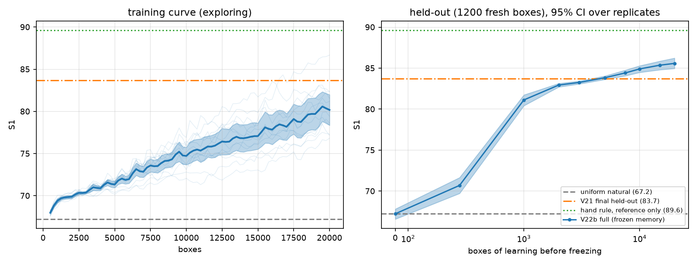
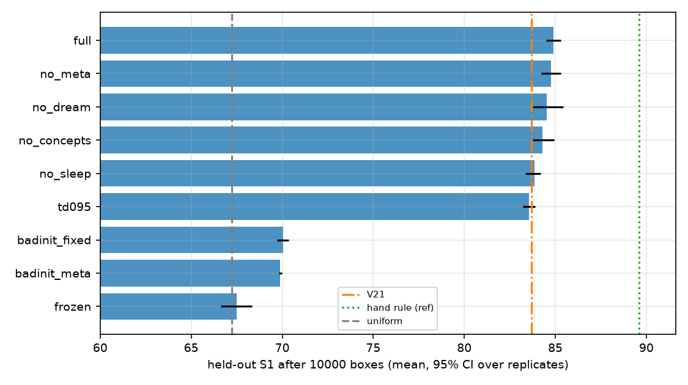
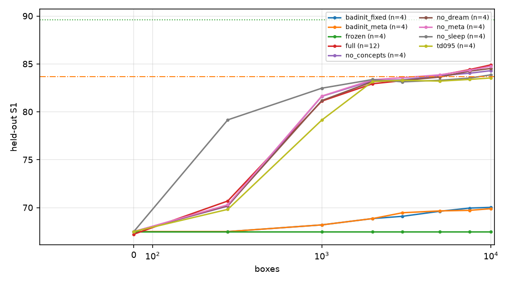
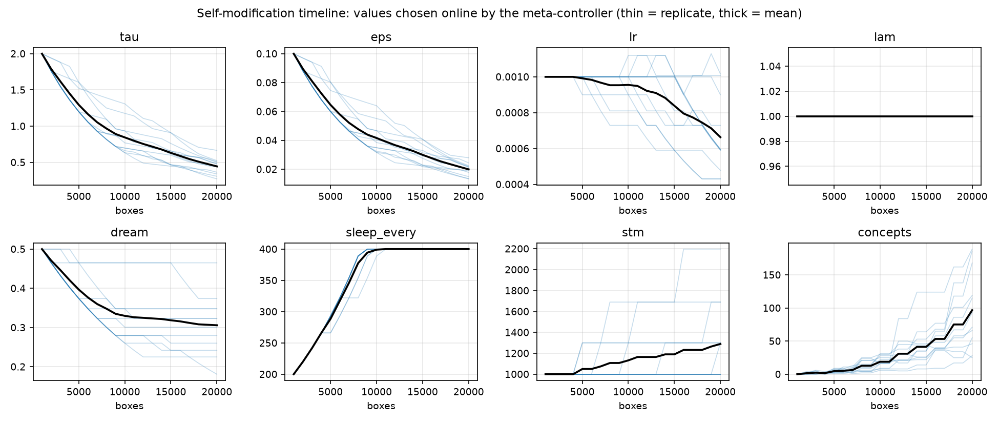
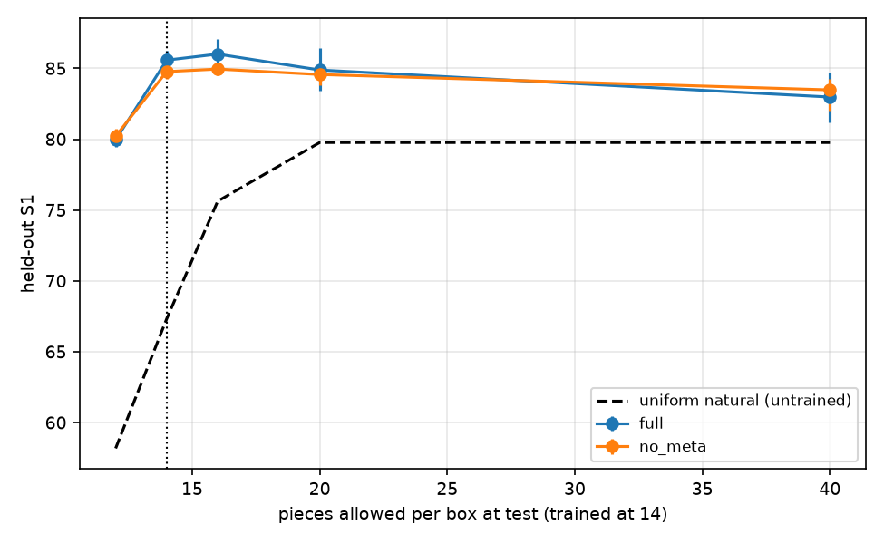

# Expt-22b - organic self-improving value learner

Run `20261001_034445_run` | code hash `d95b3495dd5324ec` | wall 118 min | 12 full replicates x 20000 boxes (equal length); ablations 4 replicates x 10000 boxes | eval set 1200 fresh boxes (seeds never used in training)

## Headline

- Uniform natural placing (untrained): held-out S1 **67.23**. V21 (additive tables, Expt-21, 12 reps, ~60-98k boxes): **83.7**. Hand contact/hole rule (reference only; never used by the learner): **89.61**.
- **V22b full, frozen memory after 20000 boxes: S1 85.58 (95% CI 84.96-86.23, 12 replicates)**; difference to V21 final +1.88 (CI +1.26, +2.53; V21 treated as a constant).
- At only 10,000 boxes: 84.91 (84.49-85.30) vs V21 at 10,000 boxes: 82.52 (82.37-82.66).
- Held-out fraction with S1>=90: 0.067; mean pieces used 13.53 of 14.

## Held-out S1 of the frozen memory (full variant)

| boxes learned | S1 | 95% CI | pieces | frac S1>=90 | hidden | concepts | replicates |
|---|---|---|---|---|---|---|---|
| 0 | 67.23 | 66.59 - 67.82 | 14.0 | 0.000 | 64 | 0 | 12 |
| 500 | 70.70 | 69.73 - 71.66 | 14.0 | 0.000 | 64 | 0 | 12 |
| 1000 | 81.12 | 80.43 - 81.74 | 13.5 | 0.001 | 64 | 0 | 12 |
| 2000 | 82.94 | 82.71 - 83.14 | 13.1 | 0.005 | 64 | 2 | 12 |
| 3000 | 83.26 | 83.08 - 83.43 | 13.0 | 0.007 | 64 | 2 | 12 |
| 5000 | 83.83 | 83.63 - 84.05 | 13.1 | 0.010 | 64 | 5 | 12 |
| 7500 | 84.42 | 84.07 - 84.76 | 13.2 | 0.023 | 64 | 9 | 12 |
| 10000 | 84.91 | 84.49 - 85.30 | 13.2 | 0.036 | 64 | 19 | 12 |
| 15000 | 85.36 | 84.81 - 85.87 | 13.4 | 0.052 | 85 | 41 | 12 |
| 20000 | 85.58 | 84.96 - 86.23 | 13.5 | 0.067 | 96 | 97 | 12 |

## Ablations (held-out S1 after 10000 boxes; 'full minus variant' = bootstrap over replicate means; p = Welch/normal approx.)

| variant | n | S1 | 95% CI | full minus variant | 95% CI | p | train S1 (last 3k) | min/stream |
|---|---|---|---|---|---|---|---|---|
| full | 12 | 84.91 | 84.49 - 85.30 | - | - | - | 74.25 | 35.0 |
| no_meta | 4 | 84.76 | 84.24 - 85.29 | +0.14 | -0.53, +0.81 | 0.706 | 73.44 | 17.8 |
| no_dream | 4 | 84.53 | 83.74 - 85.43 | +0.38 | -0.63, +1.29 | 0.488 | 73.81 | 19.7 |
| no_concepts | 4 | 84.30 | 83.75 - 84.93 | +0.61 | -0.19, +1.32 | 0.157 | 73.34 | 21.2 |
| no_sleep | 4 | 83.87 | 83.36 - 84.20 | +1.04 | +0.46, +1.69 | 0.00248 | 71.93 | 16.0 |
| td095 | 4 | 83.54 | 83.21 - 83.88 | +1.36 | +0.82, +1.90 | 5.13e-06 | 72.53 | 20.8 |
| badinit_fixed | 4 | 70.03 | 69.72 - 70.34 | +14.87 | +14.35, +15.40 | 0 | 69.42 | 18.6 |
| badinit_meta | 4 | 69.90 | 69.80 - 69.99 | +15.01 | +14.59, +15.44 | 0 | 69.54 | 19.9 |
| frozen | 4 | 67.51 | 66.63 - 68.34 | +17.40 | +16.46, +18.40 | 1.79e-195 | 67.33 | 15.8 |

Variants: `full`; `no_meta` fixed hyperparameters + V21-style tau/eps anneal, no capacity test; `no_sleep` online TD only (no replay/dreams/slow-weight LTM, no concepts; memory = fast net); `no_dream`; `no_concepts`; `td095` bootstrapped lambda-return targets (lambda 0.95, the V22a setting) instead of Monte-Carlo returns; `badinit_meta` / `badinit_fixed` deliberately poor initial hyperparameters (lr 8e-3, tau 0.3, eps 0, lambda 0.5, no dreams, sleep 800, STM 300) with / without the meta-controller; `frozen` untrained.

## Self-modification (full variant)

- 712 hyperparameter changes over 12 replicates (59 per replicate) and 32 capacity tests.
| parameter | changes | up | down |
|---|---|---|---|
| tau | 228 | 0 | 228 |
| eps | 228 | 0 | 228 |
| sleep_every | 96 | 96 | 0 |
| dream | 86 | 0 | 86 |
| lr | 64 | 6 | 58 |
| stm | 10 | 10 | 0 |
- Capacity tests: 32; widening accepted in 6; median validation-loss ratio widened/control 0.949 (<0.93 is needed to grow). Final hidden widths: {128: 6, 64: 6}.
- Every event (box, parameter, old, new, reason) is in `self_modification_events.csv`; trajectories in `fig2_self_modification`.

## Sample efficiency (boxes of learning until frozen held-out S1 reaches 50% / 90% of that stream's own total gain; checkpoint resolution)

| variant | 50% (median boxes) | 90% (median boxes) |
|---|---|---|
| badinit_fixed | 2000 | 7500 |
| badinit_meta | 2000 | 6500 |
| full | 1000 | 5000 |
| no_concepts | 1000 | 2000 |
| no_dream | 1000 | 2000 |
| no_meta | 1000 | 2000 |
| no_sleep | 500 | 1500 |
| td095 | 1000 | 2000 |

## Transfer / robustness (trained at 14 pieces per box, memory frozen; 1,000 fresh boxes per budget)

| variant | budget 12 | budget 14 | budget 16 | budget 20 | budget 40 |
|---|---|---|---|---|---|
| full | 80.0 (79.5-80.4) | 85.6 (85.0-86.2) | 86.0 (85.0-87.1) | 84.9 (83.4-86.4) | 83.0 (81.2-84.7) |
| no_meta | 80.2 (79.6-80.7) | 84.8 (84.2-85.3) | 85.0 (84.5-85.4) | 84.6 (83.8-85.2) | 83.5 (82.0-84.3) |
| frozen | 58.4 (57.6-59.1) | 67.5 (66.6-68.3) | 75.8 (74.8-76.8) | 79.7 (78.8-80.9) | 79.8 (78.7-81.2) |
| uniform natural (same boxes) | 58.2 | 67.3 | 75.6 | 79.8 | 79.8 |

## Files
`summary.md`, `fig1..fig5` (PNG+PDF), `learning_curve_full.csv`, `heldout_checkpoints.csv`, `leaderboard_ablations.csv`, `self_modification_events.csv`, `transfer.csv`, `ltm_full_seed0.pkl`, `streams/*.pkl`, `progress.log`, `manifest.json`.

## Paper-ready findings - what is and is not supported (22b: 12 replicates x 20k boxes, ablations 4 x 10k; see Expt_22c_Long_Streams for the 32k-box replication)

**Supported**: learning from 67.2 to 85.58 (CI 84.96-86.23) held-out S1, +1.88 over V21's final 83.70 (CI +1.26..+2.53) at one-third of the boxes; 84.91 at 10k vs V21's 82.52; sleep consolidation (+1.04, p=0.002) and Monte-Carlo returns over bootstrapped lambda-returns (+1.36, p<0.001) contribute; transfer to other piece budgets (+22/+18/+10/+5/+3 S1 at 12/14/16/20/40 pieces).
**Not supported**: any benefit of the meta-controller (+0.14, CI -0.53..+0.81), of dreaming (+0.38, n.s.), of the concept library (+0.61, n.s.) or of capacity growth (grown and not-grown replicates both 85.58) at this horizon; poor initial hyperparameters were not repaired by the controller in 10k boxes. Saturation was not reached (see 22c). The hand rule (89.61) and the 93 target were not reached.