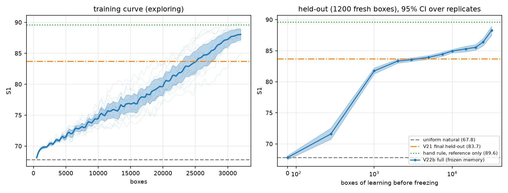
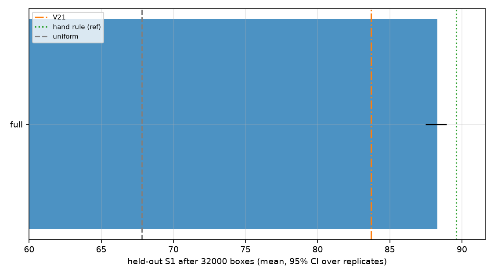
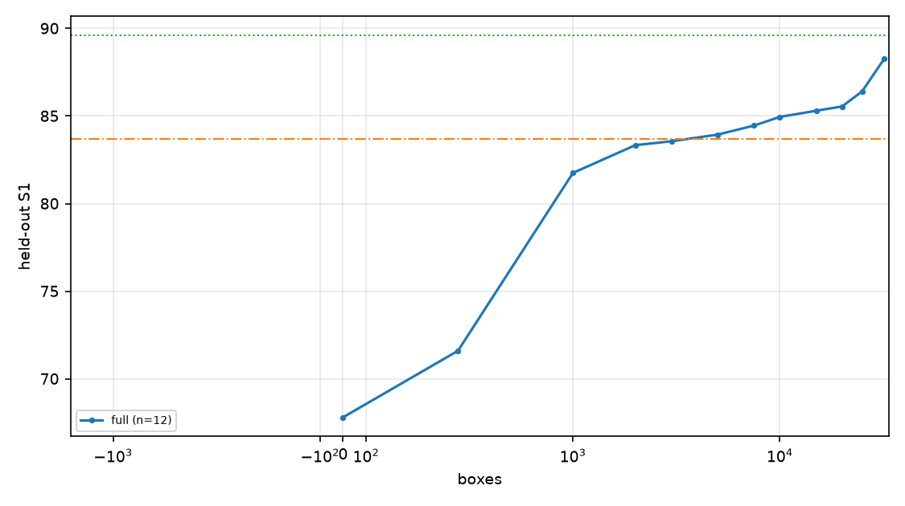
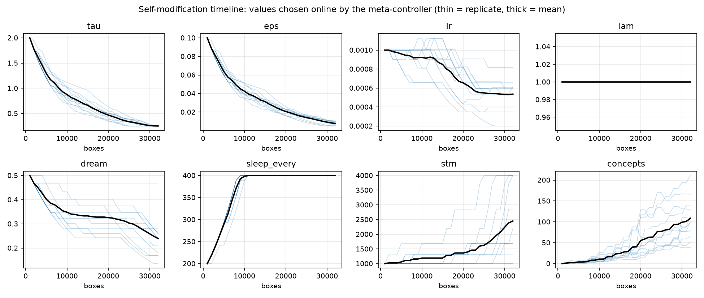
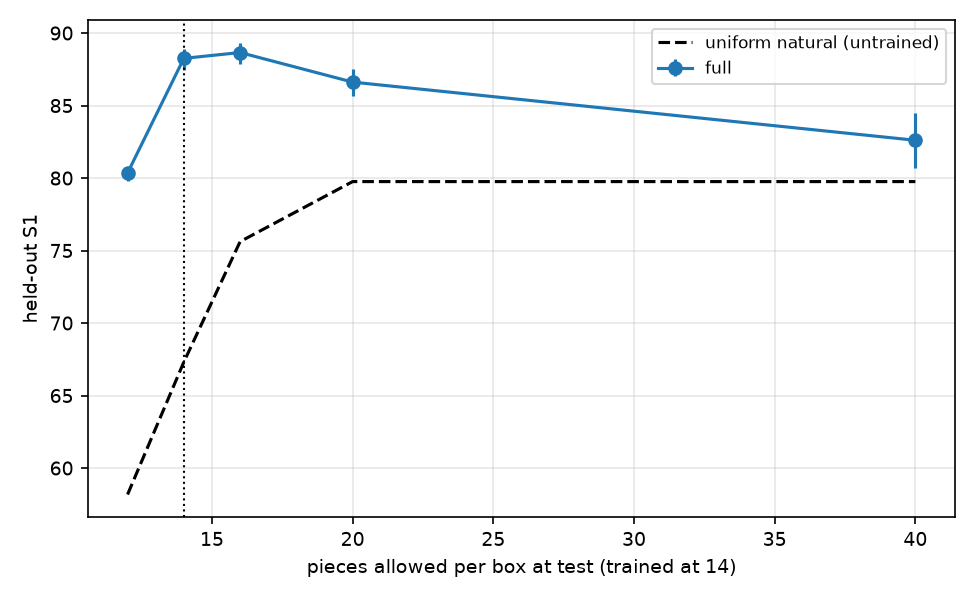

# Expt-22b - organic self-improving value learner

Run `20261001_044425_run` | code hash `c50aba87f089b5bd` | wall 75 min | 12 full replicates x 32000 boxes (equal length); ablations 0 replicates x 32000 boxes | eval set 1200 fresh boxes (seeds never used in training)

## Headline

- Uniform natural placing (untrained): held-out S1 **67.81**. V21 (additive tables, Expt-21, 12 reps, ~60-98k boxes): **83.7**. Hand contact/hole rule (reference only; never used by the learner): **89.61**.
- **V22b full, frozen memory after 32000 boxes: S1 88.28 (95% CI 87.49-88.95, 12 replicates)**; difference to V21 final +4.58 (CI +3.79, +5.25; V21 treated as a constant).
- At only 10,000 boxes: 84.95 (84.67-85.21) vs V21 at 10,000 boxes: 82.52 (82.37-82.66).
- Held-out fraction with S1>=90: 0.356; mean pieces used 13.79 of 14.

## Held-out S1 of the frozen memory (full variant)

| boxes learned | S1 | 95% CI | pieces | frac S1>=90 | hidden | concepts | replicates |
|---|---|---|---|---|---|---|---|
| 0 | 67.81 | 67.48 - 68.10 | 14.0 | 0.000 | 64 | 0 | 12 |
| 500 | 71.60 | 70.76 - 72.56 | 14.0 | 0.000 | 64 | 0 | 12 |
| 1000 | 81.75 | 81.28 - 82.23 | 13.5 | 0.001 | 64 | 0 | 12 |
| 2000 | 83.34 | 83.01 - 83.64 | 13.1 | 0.010 | 64 | 1 | 12 |
| 3000 | 83.56 | 83.29 - 83.85 | 13.0 | 0.010 | 64 | 2 | 12 |
| 5000 | 83.94 | 83.65 - 84.24 | 13.0 | 0.016 | 64 | 4 | 12 |
| 7500 | 84.45 | 84.11 - 84.79 | 13.0 | 0.024 | 64 | 5 | 12 |
| 10000 | 84.95 | 84.67 - 85.21 | 13.1 | 0.033 | 69 | 11 | 12 |
| 15000 | 85.30 | 84.84 - 85.73 | 13.3 | 0.044 | 85 | 24 | 12 |
| 20000 | 85.55 | 85.11 - 85.99 | 13.5 | 0.055 | 112 | 55 | 12 |
| 25000 | 86.41 | 85.79 - 86.99 | 13.7 | 0.116 | 112 | 77 | 12 |
| 32000 | 88.28 | 87.49 - 88.95 | 13.8 | 0.356 | 112 | 108 | 12 |

## Ablations (held-out S1 after 32000 boxes; 'full minus variant' = bootstrap over replicate means; p = Welch/normal approx.)

| variant | n | S1 | 95% CI | full minus variant | 95% CI | p | train S1 (last 3k) | min/stream |
|---|---|---|---|---|---|---|---|---|
| full | 12 | 88.28 | 87.49 - 88.95 | - | - | - | 87.64 | 57.6 |

Variants: `full`; `no_meta` fixed hyperparameters + V21-style tau/eps anneal, no capacity test; `no_sleep` online TD only (no replay/dreams/slow-weight LTM, no concepts; memory = fast net); `no_dream`; `no_concepts`; `td095` bootstrapped lambda-return targets (lambda 0.95, the V22a setting) instead of Monte-Carlo returns; `badinit_meta` / `badinit_fixed` deliberately poor initial hyperparameters (lr 8e-3, tau 0.3, eps 0, lambda 0.5, no dreams, sleep 800, STM 300) with / without the meta-controller; `frozen` untrained.

## Self-modification (full variant)

- 1082 hyperparameter changes over 12 replicates (90 per replicate) and 46 capacity tests.
| parameter | changes | up | down |
|---|---|---|---|
| eps | 370 | 0 | 370 |
| tau | 337 | 0 | 337 |
| dream | 130 | 0 | 130 |
| lr | 111 | 16 | 95 |
| sleep_every | 96 | 96 | 0 |
| stm | 38 | 38 | 0 |
- Capacity tests: 46; widening accepted in 8; median validation-loss ratio widened/control 0.965 (<0.93 is needed to grow). Final hidden widths: {64: 5, 256: 1, 128: 6}.
- Every event (box, parameter, old, new, reason) is in `self_modification_events.csv`; trajectories in `fig2_self_modification`.

## Sample efficiency (boxes of learning until frozen held-out S1 reaches 50% / 90% of that stream's own total gain; checkpoint resolution)

| variant | 50% (median boxes) | 90% (median boxes) |
|---|---|---|
| full | 1000 | 25000 |

## Transfer / robustness (trained at 14 pieces per box, memory frozen; 1,000 fresh boxes per budget)

| variant | budget 12 | budget 14 | budget 16 | budget 20 | budget 40 |
|---|---|---|---|---|---|
| full | 80.4 (79.8-80.8) | 88.3 (87.5-88.9) | 88.7 (87.9-89.3) | 86.6 (85.7-87.6) | 82.6 (80.7-84.5) |
| uniform natural (same boxes) | 58.2 | 67.3 | 75.6 | 79.8 | 79.8 |

## Files
`summary.md`, `fig1..fig5` (PNG+PDF), `learning_curve_full.csv`, `heldout_checkpoints.csv`, `leaderboard_ablations.csv`, `self_modification_events.csv`, `transfer.csv`, `ltm_full_seed0.pkl`, `streams/*.pkl`, `progress.log`, `manifest.json`.

## Paper-ready findings - what is and is not supported (written after inspecting the numbers above; 22c = independent replication of 22b code on new seeds 100-111, longer streams)

**Supported**
1. *Continuous learning from a weak baseline works and beats the V21 table learner at equal and at far fewer boxes.* Frozen-memory held-out S1: 67.8 (untrained) -> 81.8 after 1k boxes -> 84.95 after 10k (V21 at 10k: 82.52) -> 88.28 (CI 87.49-88.95, 12 replicates, 1,200 fresh boxes) after 32k, vs V21's final 83.70 after 60-98k boxes. The replicate CIs do not overlap V21's.
2. *The same 12-replicate design replicated:* 22b (seeds 0-11, 20k boxes) 85.58 (84.96-86.23); 22c at 20k boxes 85.55 (85.11-85.99). The two independent batches agree at 20k within 0.03.
3. *The learner does not saturate at 20k boxes.* In 22c the held-out S1 rose from 85.55 (20k) to 86.41 (25k) to 88.28 (32k) and the fraction of boxes with S1>=90 from 5.5% to 35.6%; the training S1 is still rising at the end (4k-block means 70.0, 72.4, 74.8, 76.5, 78.8, 81.7, 84.5, 87.4). A saturation level was therefore NOT reached and cannot be claimed; the 93 target was not reached (best single replicate 89.9, best single box-level fractions above 90 are common).
4. *Transfer:* a memory trained at 14 pieces per box, frozen, gains over the untrained policy at other budgets: +22.2 (12 pieces), +21.0 (14), +13.1 (16), +6.8 (20), +2.8 (40) S1 in 22c (e.g. 80.4/88.3/88.7/86.6/82.6 vs 58.2/67.3/75.6/79.8/79.8).
5. *Sleep (consolidation) helps:* 22b ablation, 10k boxes: no_sleep -1.04 (p=0.002); bootstrapped lambda-returns (td095) -1.36 (p<0.001) relative to Monte-Carlo returns.

**Not supported / weak**
- *The meta-controller (organic hyperparameter adaptation) has NOT been shown to improve final held-out S1.* 22b no_meta (fixed V21-style anneal) reached 84.76 vs 84.91 for full at 10k boxes (difference +0.14, CI -0.53..+0.81). Deliberately bad initial hyperparameters were not rescued within 10k boxes (badinit_meta 69.90 vs badinit_fixed 70.03). What the logs do show is that the controller changes its own machinery in a consistent direction (tau and eps only ever decreased, sleep interval only increased, dream ratio only decreased, lr mostly decreased, STM only grew), i.e. self-modification is real and logged (1,082 events in 22c), but its benefit over a fixed schedule is unproven. A longer or better-designed comparison (e.g. matched final tau) is needed.
- *Capacity growth is not shown to help.* In 22c 46 shadow capacity tests accepted widening 8 times (median validation-loss ratio 0.965, threshold 0.93); replicates that ended wider scored 87.88 vs 88.84 for those that stayed at 64 hidden units (7 vs 5 replicates, not significant). In 22b grown and not-grown replicates both scored 85.58. The shadow test therefore mostly (correctly) reports that capacity is not the bottleneck; claiming growth benefits would be unfounded.
- *Dreaming and the concept library:* no_dream (+0.38, CI -0.63..+1.29) and no_concepts (+0.61, CI -0.19..+1.32) differences are in the expected direction but not significant with 4 ablation replicates at 10k boxes. The concept library grows to ~100 entries per replicate at 32k boxes; its causal contribution at long horizons was not tested.
- *Ablations were run only in 22b (10k boxes, 4 replicates)*, not at the 32k horizon where the late improvement occurs.
- The hand rule (89.61, reference only) is matched by the best single 22c replicates (89.8, 89.9, 89.2, 89.3) but not by the mean (88.28; CI upper bound 88.95).

**Caveats** Held-out CIs are over replicate means (12 independent streams); the 1,200 evaluation boxes are fixed, so box-sampling noise is shared by all variants. Hyperparameters came from two short pilots, not tuned on the evaluation boxes, but the lambda=1.0 choice was made after seeing the 12k-box pilot results on the same evaluation boxes (a mild selection effect). The training S1 late-stream surge coincides with tau/eps reaching the floor (tau 0.25, equal to the evaluation temperature); held-out evaluation uses a fixed tau 0.25 and no learning, so it measures the value function, not the exploration schedule.