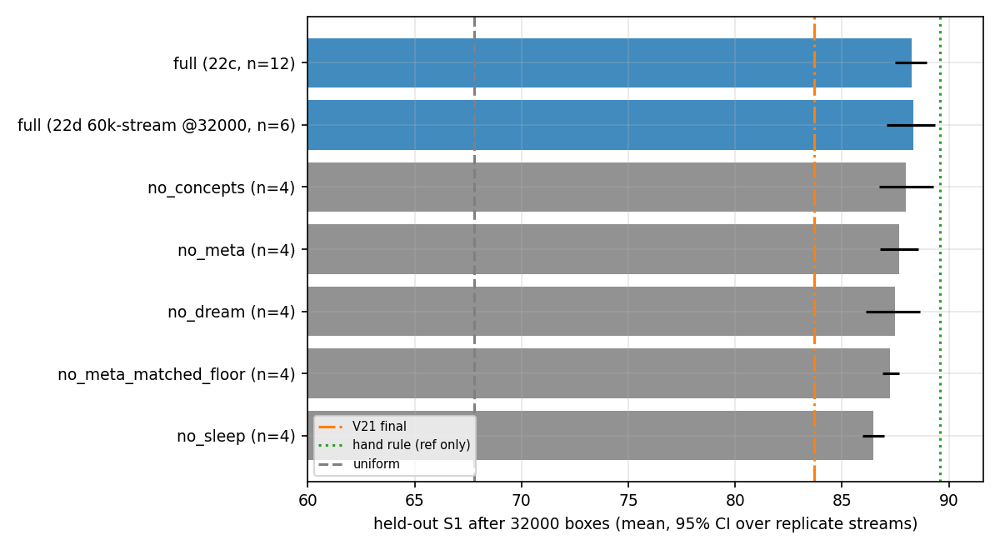
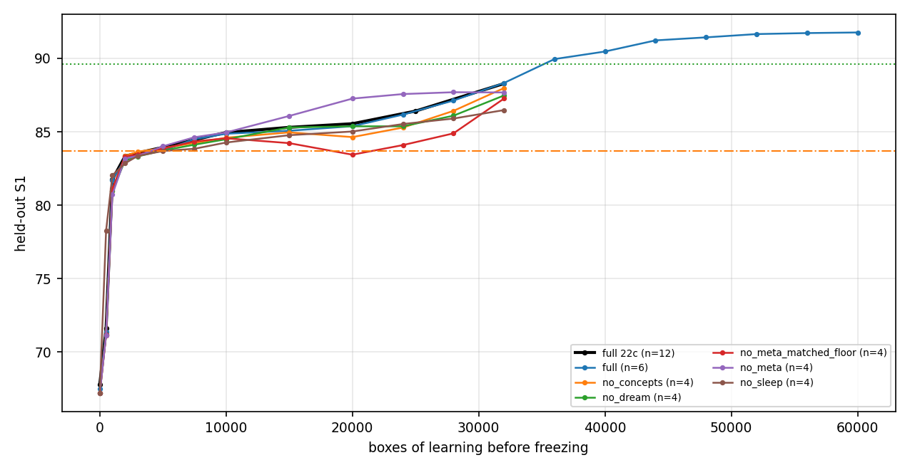
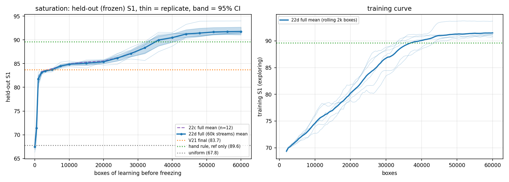
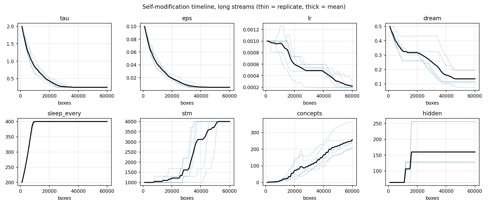

# Expt-22d - long-horizon ablations and saturation of the organic value learner

Run `20261001_060654_main` | code hash `05907550c5739d90` | generated 2026-10-01 07:08 IST | **12 streams finished, 14 still running (partial snapshots)**

Design: `full` x 6 streams of 60000 boxes (seeds 300+; held-out checkpoints every 4k boxes after 20k); ablations x 4 streams of 32000 boxes (seeds 200+): no_meta, no_meta_matched_floor, no_dream, no_concepts, no_sleep. Reference = Expt-22c `full`, 12 streams (seeds 100-111) at 32000 boxes. Held-out = frozen memory on 1200 fresh boxes (same boxes as 22b/22c). Progress (min-max boxes done per variant): no_concepts 15000-32000, no_dream 24000-32000, no_meta_matched_floor 32000-32000, no_meta 32000-32000, no_sleep 32000-32000, full 20000-36000.

Reminder: `no_meta` = fixed hyperparameters + V21-style anneal (tau 2.0->0.35, eps 0.10->0.01 over 15k boxes, then constant); `no_meta_matched_floor` = fixed hyperparameters, tau 2.0->0.25 and eps 0.10->0.0077 linearly over 32k boxes (the floors the meta-controller reached in 22c; the meta-controller's own tau trajectory is shown in fig_self_modification_long). `no_sleep` = online TD only; `no_dream`; `no_concepts`.

## 1. Long-horizon ablations (held-out S1 after 32000 boxes)

- Reference `full` (22c, n=12): **88.28 (87.49-88.95)**. `full` streams of this run at the same 32k checkpoint (n=1): 89.61 (nan-nan); pooled n=13: 88.38 (87.65-89.00).

| variant | n finished (+running) | S1 | 95% CI | full(22c) minus variant | 95% CI | p (Welch) | full(pooled) minus variant (95% CI) | frac S1>=90 | train S1 last 3k |
|---|---|---|---|---|---|---|---|---|---|
| no_dream | 2 (+2) | 88.12 | nan - nan | +0.17 | -1.33, +1.58 | 0.874 | +0.27 (-1.15, +1.68) | 0.322 | 87.63 |
| no_meta | 4 (+0) | 87.68 | 86.79 - 88.57 | +0.60 | -0.58, +1.71 | 0.362 | +0.71 (-0.47, +1.80) | 0.258 | 85.18 |
| no_concepts | 1 (+3) | 87.48 | nan - nan | +nan | +nan, +nan | nan | +nan (+nan, +nan) | 0.193 | 86.89 |
| no_meta_matched_floor | 4 (+0) | 87.26 | 86.90 - 87.66 | +1.02 | +0.16, +1.81 | 0.0231 | +1.13 (+0.27, +1.87) | 0.171 | 84.50 |
| no_sleep | 4 (+0) | 86.48 | 85.97 - 86.98 | +1.81 | +0.92, +2.67 | 0.000255 | +1.91 (+1.01, +2.73) | 0.114 | 83.17 |

Floor diagnostic: training S1 over boxes 29000-32000: no_meta 85.18, no_meta_matched_floor 84.50, full(22c) 87.64.

## 2. Saturation run (full, long streams)

| boxes learned | S1 | 95% CI | frac S1>=90 | hidden | concepts | replicates |
|---|---|---|---|---|---|---|
| 0 | 67.51 | 66.84 - 68.22 | 0.000 | 64 | 0 | 6 |
| 500 | 71.40 | 69.98 - 72.83 | 0.000 | 64 | 0 | 6 |
| 1000 | 81.73 | 80.74 - 82.60 | 0.002 | 64 | 0 | 6 |
| 2000 | 83.14 | 82.87 - 83.35 | 0.006 | 64 | 2 | 6 |
| 3000 | 83.43 | 83.27 - 83.57 | 0.008 | 64 | 2 | 6 |
| 5000 | 83.72 | 83.51 - 83.88 | 0.010 | 64 | 3 | 6 |
| 7500 | 84.50 | 84.20 - 84.86 | 0.022 | 64 | 4 | 6 |
| 10000 | 84.87 | 84.61 - 85.17 | 0.027 | 64 | 12 | 6 |
| 15000 | 85.07 | 84.60 - 85.48 | 0.030 | 107 | 23 | 6 |
| 20000 | 85.39 | 85.04 - 85.72 | 0.040 | 160 | 74 | 6 |
| 24000 | 86.26 | 85.76 - 86.80 | 0.094 | 112 | 120 | 4 |
| 28000 | 87.43 | nan - nan | 0.237 | 96 | 146 | 2 |
| 32000 | 89.61 | nan - nan | 0.596 | 64 | 180 | 1 |
| 36000 | 91.58 | nan - nan | 0.938 | 64 | 217 | 1 |

## 3. Self-modification in the long streams (full)

432 hyperparameter changes over 6 streams so far (72/stream), 19 capacity tests (7 accepted). eps: 142 (up 0, down 142); tau: 136 (up 0, down 136); dream: 53 (up 0, down 53); sleep_every: 48 (up 48, down 0); lr: 47 (up 4, down 43); stm: 6 (up 6, down 0). Full event list: `self_modification_events_long.csv`.

## 4. Paper-ready findings (auto-generated from the numbers above; PARTIAL if runs unfinished)

**Supported (CI excludes 0):**
- `no_meta_matched_floor` (n=4): 22c-full minus variant +1.02 (CI +0.16, +1.81) -> full is significantly better
- `no_sleep` (n=4): 22c-full minus variant +1.81 (CI +0.92, +2.67) -> full is significantly better

**Not supported / inconclusive:**
- `no_dream` (n=2): 22c-full minus variant +0.17 (CI -1.33, +1.58) - too few finished replicates to judge
- `no_meta` (n=4): 22c-full minus variant +0.60 (CI -0.58, +1.71) -> not distinguishable (CI includes 0)
- `no_concepts` (n=1): 22c-full minus variant +nan (CI +nan, +nan) - too few finished replicates to judge

**Saturation:** latest long-stream checkpoint 36000 boxes: S1 91.58 (nan-nan), n=1; frac S1>=90 0.938. The long streams are NOT finished; no saturation claim can be made yet.

**Caveats:** ablations use 4 replicates (low power; CIs are over replicate streams only; the 1,200 evaluation boxes are fixed and shared by all variants); the reference full(22c) used different seeds (100-111) than the ablations (200-203), which is valid but not paired; V21 CI treats V21 as a constant; hand rule is a reference only.